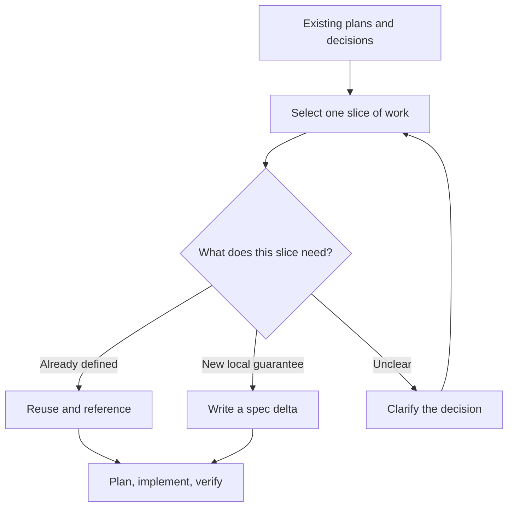

# Build on the decisions you've already made

> **Draft launch post:** This is a broader product exploration, not a shipped release. The current [lifecycle pilot](../lifecycle/design-draft.md) keeps the existing generation workflow and adds checks and optional reviews. The contract and verification ideas below are separate work.

*OpenSpec helps coding agents turn existing plans into focused changes, carrying forward what matters and defining only what still needs to be worked out.*

The requirements are in Linear. The architecture is in a design document. Someone has already explored the user journeys and made the important trade-offs.

An engineer points their coding agent at that work and says: “Create an OpenSpec change for the iOS checkout flow.”

The difficult part isn't finding the documents or generating a proposal. It's deciding **what belongs in this change**.

The checkout requirements cover iOS, Android, web, and backend. Some guarantees have already been agreed. Others need to be worked out for iOS. Copy everything into local specs, and you create another contract to maintain. Link to everything without making decisions, and you haven't given the agent a clear implementation target.

This happens on large teams, where product, architecture, and design are handled by different people. It also happens when one developer spends a week exploring a feature, then returns to implement it one piece at a time. The handoff is from **broader planning to a specific change**, not necessarily from one person or tool to another.

OpenSpec now helps with that handoff.

## Shape the change before writing the artifacts

An OpenSpec change is a unit of work. In the standard workflow, its proposal captures why and what, its spec deltas propose changes to maintained behavior, its design explains the technical approach, and its tasks guide implementation.

Before drafting those artifacts, the agent now makes four judgments:

- **What is already decided?** Find applicable requirements, constraints, contracts, designs, and decisions.

- **What does this change own?** Identify the specific slice of work and what remains outside it.

- **What is still missing?** Define new local guarantees when needed, and ask about consequential ambiguities.

- **How will we know it works?** Identify useful tests, demos, simulations, or other evidence.

These are judgments the agent makes as part of planning, not four new forms for developers to complete. It explains important choices before committing to a plan so you can correct them.



This isn't a new classification of “product requirements” versus “engineering requirements.” A product document may already contain precise, testable behavior. An architecture decision may establish a performance target. The important question is **which guarantees apply here, and whether this change needs to establish or modify any of them**.

## Example: implement the iOS side of checkout

A product team already has checkout requirements, a pricing API contract, and design documents. The iOS engineer wants to implement the confirmation flow, not invent a second checkout specification.

In the coding agent's chat, they use the OpenSpec command they already know:

```text
/opsx:propose implement-ios-checkout

Use the shared checkout requirements and pricing API contract.
Implement the iOS confirmation flow. Backend pricing and Android
are separate work.
```

The agent reads the sources it can access, inspects the iOS codebase, and explains its proposed boundary:

> **Use as-is:** The shared checkout contract requires the final price to be displayed before confirmation. The pricing API defines when quotes expire.
>
> **Implement here:** The iOS confirmation UI and its interaction with the pricing API.
>
> **Needs a decision:** What should happen if the app resumes after the quote has expired?
>
> **Verify with:** UI and integration tests for valid and expired quotes, plus a confirmation-flow demo.

After the engineer resolves the open question, OpenSpec creates a normal change. Its proposal links to the shared contracts, and its design and tasks cover the iOS implementation.

```text
openspec/changes/implement-ios-checkout/
├── .openspec.yaml
├── proposal.md   # scope, source links, decisions
├── design.md     # iOS implementation approach
└── tasks.md      # implementation and verification steps
```

**There's no requirement to copy the shared contract into iOS delta specs just because iOS is implementing it.** A change can implement an existing contract without proposing changes to that contract. The implementation still has concrete expectations to satisfy.

If the team decides that iOS must prevent confirmation until a fresh quote has been displayed after the app resumes, that's an additional iOS guarantee. The agent can capture it as a local spec delta:

```markdown
## ADDED Requirements

### Requirement: Refresh expired checkout quotes
The iOS app SHALL prevent checkout confirmation when its
current price quote has expired.

#### Scenario: Return to an expired quote
- WHEN the app resumes with an expired quote
- THEN confirmation remains disabled until a fresh quote is shown
```

That delta updates the iOS app's maintained specs through the usual sync or archive process. The shared checkout contract stays where it is maintained. The backend and Android engineers can take separate slices of the same overall work.

The same reasoning works for an individual developer returning to earlier user journeys and prototypes, or a platform engineer implementing an ADR and a failover benchmark. The sources differ; the job of shaping a reliable change is the same.

## What's new in this release

The workflow still starts with familiar OpenSpec commands. What's changed is **what the agent does with the information you give it**.

### 1. Start from an existing plan, not a blank proposal

Point `/opsx:explore` or `/opsx:propose` at a Markdown file, another checked-out repository, a design, or an issue available through the agent's tools. The agent identifies the relevant context before drafting. It doesn't ask you to recreate decisions already captured there.

### 2. Review the boundary of the change

Before writing the plan, the agent briefly explains what it will reuse, what this change will implement, what needs defining locally, and what still needs clarification. You can correct its interpretation instead of reviewing a stack of generated files after the fact.

### 3. Implement existing contracts without making duplicate specs

When applicable behavior is already precisely defined elsewhere, the change can reference and implement it without creating redundant local delta specs. When a component introduces or modifies a lasting guarantee of its own, the agent writes a local delta for that guarantee.

For example, a proposal can carry the relationship in ordinary Markdown:

```markdown
## Context and scope

This change implements the iOS confirmation flow from the
[shared checkout requirements](https://example.com/checkout-requirements).
It follows the [pricing API contract](https://example.com/pricing-api).

Backend pricing and Android checkout are outside this change.
```

No new knowledge format or per-paragraph IDs are required. The link tells the agent where to look; the surrounding words explain why it matters.

### 4. Verify against the applicable contracts

When you ask the agent to verify the change, it considers the shared expectations used in planning alongside local specs and design decisions. It records what evidence supports each important claim and where evidence is missing.

```text
Supported    Expired quotes cannot be confirmed (UI test)
Supported    Displayed amount matches accepted quote (integration test)
Unverified   Behavior during pricing-service outage
Out of scope Android checkout
```

Passing a test supports the behavior it actually checks; it doesn't mean the whole checkout initiative is delivered. If a source is inaccessible or has changed in a way that makes the expected behavior unclear, the agent says so rather than reporting a clean result.

### 5. Revisit the sources when plans evolve

While updating a change, ask the agent to re-read its linked sources and explain what might affect the plan:

```text
/opsx:update implement-ios-checkout

Review the linked checkout requirements and pricing API.
What has changed that could affect this plan? Suggest revisions,
but don't edit either source without my review.
```

A changed document doesn't automatically mean a broken implementation. The agent helps assess the relevance of a change and propose follow-up work. Historical comparisons are only as precise as the source revisions or snapshots available. Nothing is silently synchronized.

## Getting started

**1. Make the source available to your agent.** Keep your Markdown files where they are, open another Git repository alongside your code, or connect the relevant external tool through your coding agent. A pasted Notion or Linear URL doesn't itself grant OpenSpec access. Use whatever access the agent already has.

**2. Start a change using your existing workflow.** In the agent's chat:

```text
/opsx:propose implement-ios-checkout

Use docs/checkout-requirements.md and the pricing contract
in ../shared-contracts/pricing.md. Implement only the iOS
confirmation flow, and show me what you plan to reuse or define.
```

The agent proposes the scope, creates the change artifacts after important decisions are clear, and preserves the source links and their meaning in the plan. Review the proposed boundary just as you would review the design.

**3. Implement, verify, and archive.** Continue with `/opsx:apply`, then verify the implementation and archive the change. The expanded OpenSpec command profile includes `/opsx:verify`; users on the core profile can enable it through `openspec config profile` followed by `openspec update`.

### Configure team conventions when you need them

No special integration file or knowledge format is required. For shared practices, use the project configuration OpenSpec already understands:

```yaml
# openspec/config.yaml
schema: spec-driven

context: |
  Checkout rules are maintained by the shared checkout team.
  Mobile changes implement platform-specific slices.

rules:
  proposal:
    - Identify the relevant shared decisions and the local scope.
    - Keep links to sources that informed this change.
  specs:
    - Define new or modified guarantees owned by this component.
    - Reuse shared contracts instead of reproducing their text.
```

The configuration gives the agent conventions; it doesn't fetch private documents or create new approval rules. Teams can keep their existing schema or customize artifact guidance. Existing OpenSpec *store references* remain a separate way to discover specs maintained in another OpenSpec store.

## What stays the same, and what's next

You can still start from a rough idea and define new behavior directly in OpenSpec. Existing proposals, local delta specs, designs, tasks, and archive history keep their roles. A developer doing everything in one repository doesn't need a separate planning system.

This release focuses on shaping changes from existing information, preserving useful links, implementing against applicable contracts, and reviewing evidence. It doesn't provide automatic two-way sync, universal approval checks, or guarantees that every external tool is accessible or every historical version can be reconstructed.

Next, shared OpenSpec Projects can organize broader context and work across repositories, documents, and sessions. An observer can eventually discover relationships and flag relevant changes proactively, rather than waiting for someone to request a review. Those are future capabilities, not prerequisites for using this workflow.

**When you're ready to build one part of a larger plan, OpenSpec helps your agent carry forward what's already decided, define what's missing, and prove what the change actually delivers.**
