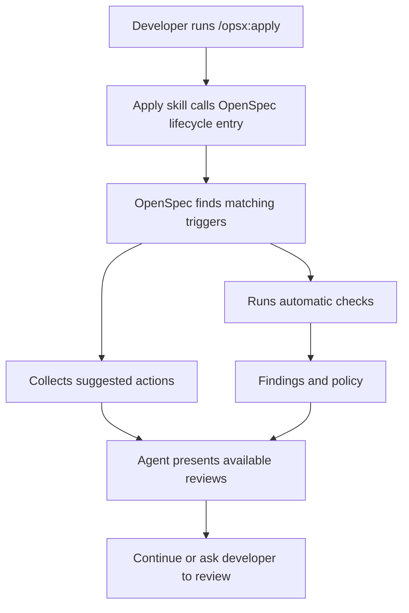
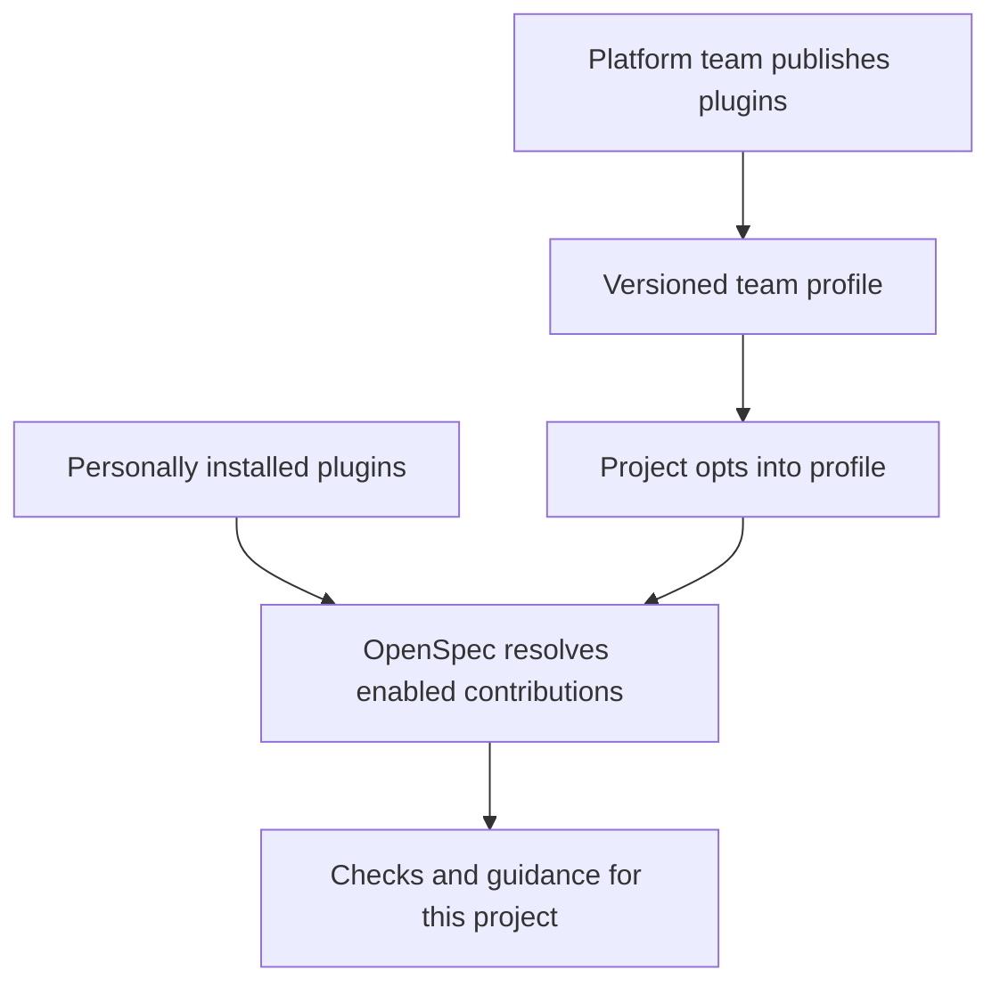

# Introducing lifecycle checkpoints

*Run useful checks and offer optional next steps as work moves from planning to implementation, without changing your OpenSpec workflow.*

> **Imagined launch, updated November 5, 2026:** Actions and triggers are the selected model. Configuration and CLI examples remain proposed, not available in OpenSpec today. The [technical design](lifecycle-checkpoints.md) owns the model; the [roadmap](../direction/roadmap.md) owns delivery order. This draft illustrates the initial pilot and clearly marked later extensions.

Your team agrees on checkout requirements in another repository. You create an OpenSpec change and start building. A week later, someone updates the requirements.

How will you know the change you're implementing is still based on the right information?

**Lifecycle checkpoints** let you record what a change depends on and choose what happens at key moments. OpenSpec can run a check automatically, or suggest a review that your agent will only perform if you ask. Nothing silently rewrites the source or your engineering decisions.

## What's new

- **Sources:** Record the documents and revisions behind a change.

- **Actions:** Run a built-in check or offer a guided agent review. Team-owned executable checks come later.

- **Triggers:** Choose when an action runs or is suggested, such as before Apply or after tasks finish.

- **Execution modes:** Run executable checks automatically, or suggest an optional agent action.

- **Policies:** Warn when an executed check finds drift or cannot establish a result. Blocking is deferred.

- **Existing workflows:** Keep using your usual OpenSpec skills and artifact schemas. Nothing changes in projects that haven't enabled checkpoints.

## 1. Record what a change depends on

A **source** is anything that informed the work: a requirement, architecture decision, design, issue, or shared contract. Its owner continues maintaining it. OpenSpec records what your change used; it doesn't become the source's new owner.

| Source | Who maintains it? | What OpenSpec can track initially |
| --- | --- | --- |
| Markdown, an ADR, or an upstream product specification in Git | That repository's owners | The file and a pinned Git revision |
| Linear, Notion, or Figma | People using that service | A link; automated revision checks need an integration |
| A spec in an OpenSpec Store | The Store's owners | Existing Store reference; a Git file can also be pinned |

For example, an agent preparing `ios-checkout` proposes this source reference, and the developer confirms it:

```yaml
# openspec/changes/ios-checkout/.openspec.yaml
schema: spec-driven
sources:
  - id: checkout-requirements
    type: git-file
    repository: https://github.com/example/product-requirements.git
    path: features/checkout.md
    revision: 6a81f32
    track: main
```

`revision` is the version used to plan the change. It **stays pinned** until someone explicitly accepts a new baseline. `track` tells the checker which branch to compare against when asked. Neither field updates the original document.

OpenSpec doesn't continuously watch sources in the initial pilot. A Git checker runs when invoked, compares the **file contents** at the pinned revision with the tracked version, and reports *unchanged*, *changed*, or *unknown*. Unrelated commits don't count; changes within the file, including metadata edits, do. If the revision or repository isn't accessible, the result is unknown, not a pass.

## 2. Choose what runs and when

Configure actions and triggers in the existing `openspec/config.yaml`. No second YAML file or custom artifact schema is needed. The Apply trigger belongs to the pilot; the Archive trigger illustrates the next integration.

```yaml
# openspec/config.yaml
schema: spec-driven

actions:
  source-drift:
    uses: builtin/git-file-drift

triggers:
  - on: openspec.apply.before
    run: source-drift
    mode: auto
    policy: warn

  - on: openspec.archive.before
    run: source-drift
    mode: auto
    policy: warn
```

An **action** describes work to do. A **trigger** binds an event to an action. Its **mode** decides whether OpenSpec runs an executable check (`auto`) or offers an agent-guided action (`suggest`). A **policy** determines how OpenSpec handles a check's result. The same action can be used at several points.

`mode` and `policy` are separate: **suggesting a review isn't a warning, and accepting a suggestion isn't the same as passing a check.**

### Proposed entry points

| Event | Caller | Scope |
| --- | --- | --- |
| `openspec.apply.before` | Apply skill, when starting or resuming implementation | Initial pilot |
| `openspec.apply.completed` | Apply skill, after confirming tracked tasks are complete | Initial pilot |
| `openspec.archive.before` | CLI, before archive mutations | Follow-up integration |

Manual invocation and custom callers use the same interface. Propose, Verify, and custom artifact events follow demonstrated needs. Before Propose, candidate sources would need to be passed explicitly because no change may exist yet. Validation hooks are deferred until their use and recursion behavior are defined.

These are explicit entry points. They do not watch work in the background. `apply.completed` means tracked tasks are complete, not that verification passed or the feature was released.

### Supported modes and policy

The pilot supports two combinations: a built-in check with `mode: auto` and `policy: warn`, or agent guidance with `mode: suggest` and no policy. Validate these combinations; automatic agent guidance and blocking suggestions are unsupported.

An unavailable or inconclusive check reports **unknown**, never a pass. The initial pilot warns and continues. Blocking comes later, after its error and unknown-result behavior is defined. Allowing unknown results to continue under a blocking policy would be fail-open, not successful verification.

## 3. How checkpoints actually run

This is the distinction that matters: **OpenSpec can enforce checks in its own CLI, but agent skills must request checks explicitly.**

| Entry type | Example | Guarantee |
| --- | --- | --- |
| **CLI-controlled** | `openspec archive` | OpenSpec itself executes the configured check before the operation. |
| **Skill-triggered** | `/opsx:apply` initially; other skills later | The skill calls OpenSpec before continuing. It depends on the agent following the skill. |
| **External** | A custom upstream integration skill or CI job | That tool calls the same interface; its own integration decides when to do so. |

Here's what happens when you run `/opsx:apply`:



The Apply skill would make one general call before implementing:

```bash
# Proposed skill-internal call
openspec lifecycle enter apply --change ios-checkout --json
```

It doesn't need to know about the upstream provider or `source-drift`. OpenSpec resolves the configuration and returns findings and suggestions separately. Exact CLI spelling is still proposed. Later Propose and Verify integrations can use the same pattern with their own inputs.

Instruction and status reads do not run actions. Apply refreshes instructions during its task loop, so lifecycle entry and completion must be explicit calls outside those reads. Suppress repeated offers within an invocation; define retry and resume behavior before shipping.

Custom agent skills can call this entry point too. There is **no requirement** to use the built-in OpenSpec skills, but a custom skill that never invokes the entry point won't trigger its checks.

The planned Archive integration runs the check directly and initially warns. A future gate could stop a CLI operation OpenSpec owns. An Apply skill cannot prevent an agent from editing files through some other path.

## 4. What your agent sees

Suppose the checkout requirements changed after planning. When you run `/opsx:apply`, the deterministic Git action reports:

```text
Source: checkout-requirements
Result: CHANGED
Planned revision: 6a81f32
Current revision: 9b02e17

The checkout requirements changed since this work was planned.
Review the difference before continuing.
```

The agent can then help compare the versions and explain what might affect the iOS implementation. **That's a separate review, not part of the Git check.** The developer decides whether to keep building, revise the change, or send feedback upstream. No file is silently synchronized.

The same entry call can also return **suggested actions**. In that case, OpenSpec only tells the agent what review is available; nothing executes until the developer opts in.

You can run the executable checks yourself, without starting a skill:

```bash
# Proposed CLI
openspec checks run --change ios-checkout --at openspec.apply.before
```

This command runs **executable checks**, not an AI agent. It can detect a changed file; it cannot independently decide what that change means for your product. Suggested agent actions are surfaced through the skill-driven lifecycle response; they are not automatically launched by `checks run`.

## 5. Later: add team-owned executable checks

A team may already have a readiness checker it wants to reuse. After the built-in pilot, prove a second integration before freezing an extension contract. External executables need explicit trust, bounded inputs, timeouts, permissions, and structured results. Merely cloning a repository or enabling configuration must not authorize arbitrary command execution.

The first pilot does not support arbitrary commands. The plugin and profile model below describes later distribution, not an initial installation requirement.

## 6. Offer an agent review when it's useful

Some work can't be reduced to a pass/fail check. After implementing checkout, an engineer might want to ask: *Did we discover something that the upstream product team should know?*

That isn't something to run automatically after every change. Instead, a trigger can **suggest** an agent review.

```yaml
# openspec/config.yaml (proposed)
actions:
  upstream-feedback:
    uses: agent-guidance
    instructions: |
      Read the pinned product requirements and this change's
      implementation notes, decisions, and verification evidence.
      Identify deviations, unclear requirements, or new findings.
      Prepare feedback with source references and evidence.
      Do not change upstream requirements or submit feedback without approval.

triggers:
  - on: openspec.apply.completed
    run: upstream-feedback
    mode: suggest
```

When `/opsx:apply` finishes its tracked tasks, the Apply skill calls the lifecycle entry point. OpenSpec returns the available action, and the agent might say:

> Implementation tasks are complete. Want me to review the work for findings or deviations worth sending to the upstream product team?

The developer can **run it, skip it, or request it again later**. There is no persistent deferred-review inbox in the pilot. If they choose to run it, the agent follows the supplied instructions in the **current agent session**, using the tools and context it has access to. It drafts feedback for review. It doesn't automatically open a pull request, update a locked specification, or mark the whole feature delivered.


**This is a suggested action, not an automatic check.** The CLI can return instructions but doesn't launch an agent or claim the review passed. A completed agent review may produce useful findings; it doesn't change the status of an unrelated deterministic check.

This first version uses the active agent session. Starting a fresh agent, scheduling reviews, resuming them later, and recording durable approval states would require additional execution support. An upstream integration plugin could eventually supply these instructions, rather than repeating them in every project's config.

## 7. Coming next: share plugins across a team

The initial pilot uses built-ins and local guidance. Later, a platform team should be able to share actions and triggers across repositories without copying their definitions everywhere.

We're working toward three separate controls:

- **Publish:** A platform team maintains a versioned plugin in its own repository or package registry. It can contain executable checks, suggested agent actions, event subscriptions, and guidance.

- **Install:** Developers make trusted plugins available on their machines. Installing a plugin does **not** automatically enable it everywhere or run its code.

- **Enable:** A project chooses which plugins apply. The same installed plugin can be active in one repository and inactive in another.

A future setup might look like this:

```bash
# Proposed CLI, beyond the initial pilot
openspec plugins install @acme/openspec-product-requirements@1.2.0
```

```yaml
# openspec/config.yaml in one project (proposed)
schema: spec-driven
plugins:
  - use: "@acme/openspec-product-requirements@1.2.0"
```

**Multiple plugins can be enabled at once.** If Product Requirements and Security both register a check before Apply, OpenSpec runs both and shows both results. Each plugin owns its own namespaced actions; one plugin doesn't edit another's instructions or schema.

### One shared setup for many repositories

A platform team could also publish a **versioned profile** containing the plugin choices and trigger configuration:

```yaml
# @acme/openspec-engineering@1.0.0 (proposed)
plugins:
  - "@acme/openspec-product-requirements@1.2.0"
  - "@acme/openspec-security@1.0.0"
```

Each service would opt into it with one reference:

```yaml
# openspec/config.yaml (proposed)
schema: spec-driven
extends:
  - "@acme/openspec-engineering@1.0.0"
```

The project keeps its own artifact schema. The shared profile supplies additional capabilities and defaults. A future status command would show which plugins, versions, rules, and profiles are active and where they came from.

Updates would be explicit and versioned. Project-specific additions could coexist with shared defaults; organization-enforced policies would need separate, clearly defined controls rather than relying on silent overrides. Executable plugin code would still require a trust decision.



This is a **future distribution model**, not a requirement for the initial lifecycle pilot. There is no plugin marketplace or remote administration service in the initial scope.

## 8. Further ahead: your own events and agent orchestration

Teams have workflows beyond the built-in OpenSpec commands. A custom schema might include a `security-review` artifact. A team might split implementation into phases and want to run a check after one phase finishes.

The same action system can support **custom event names**, provided the relevant skill, CLI, or external tool actually emits them. For example, a custom workflow could emit `team.security-review.completed`. An event declaration alone doesn't watch files or know when an agent finishes a task.

The initial pilot can **suggest** an agent review in the current session. Later, the runtime could actually launch an agent, track a review across sessions, wait for human approval, or chain several actions. Those features need durable run state, context handoff, and resume behavior. They are **not** part of the initial pilot.

## What belongs in the pilot

The initial lifecycle pilot combines optional Git pins, a built-in drift check before Apply, and an optional agent review after Apply. It uses explicit triggers, warning-only results, and the current agent session. Manual invocation and a custom caller test the same interface.

Archive integration, additional events, external executables, and plugin distribution follow the [roadmap](../direction/roadmap.md). Neither the pilot nor later packaging replaces the artifact graph or solves implementing external contracts without duplicate local specs.

**The goal:** Run useful checks at meaningful points and offer next steps the developer can choose.
