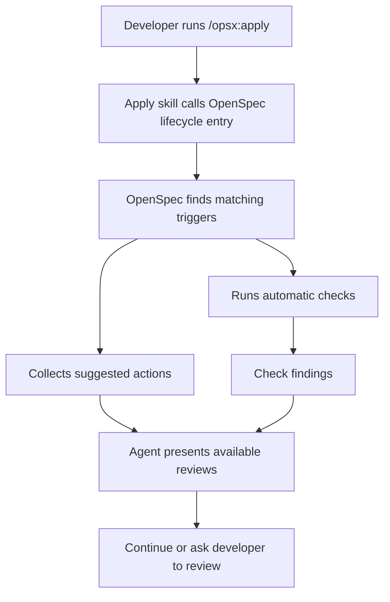
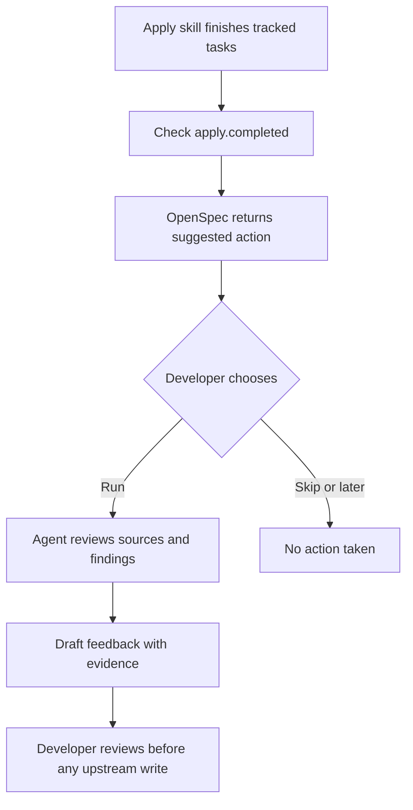
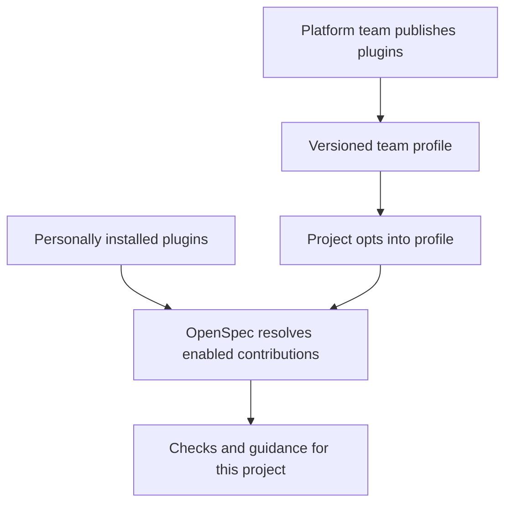

# Introducing lifecycle checkpoints

*Run useful checks and offer optional next steps as work moves from planning to implementation, without changing your OpenSpec workflow.*

> **Imagined launch:** This describes the experience we're building toward. The commands and configuration are proposed, not available today. See the [pilot design](lifecycle-checkpoints.md) for what we try first and the [roadmap](../direction/roadmap.md) for what follows.

Your team agrees on checkout requirements in another repository. You create an OpenSpec change and start building. A week later, someone updates the requirements.

How will you know the change you're implementing is still based on the right information?

**Lifecycle checkpoints** let you record what a change depends on and choose what happens at key moments. OpenSpec can run a check automatically, or suggest a review that your agent will only perform if you ask. Nothing silently rewrites the source or your engineering decisions.

## What's new

- **Sources:** Record the documents and revisions behind a change.

- **Actions:** Run a built-in check or offer a guided agent review. Team-owned executable checks come later.

- **Triggers:** Choose when an action runs or is suggested, such as before Apply or after tasks finish.

- **Findings:** Show what a check found, including when it couldn't reach a conclusion.

- **Existing workflows:** Keep using your usual OpenSpec skills and artifact schemas. Nothing changes in projects that haven't enabled checkpoints.

## 1. Record what a change depends on

A **source** is anything that informed the work: a requirement, architecture decision, design, issue, or shared contract. Its owner continues maintaining it. OpenSpec records what your change used; it doesn't become the source's new owner.

| Source | Who maintains it? | What OpenSpec can track initially |
| --- | --- | --- |
| Markdown, an ADR, or an upstream product specification in Git | That repository's owners | The file and a pinned Git revision |
| A Confluence requirements page | The product or architecture team | A link; comparing revisions needs a connector and a recoverable baseline |
| A Linear issue or project | The team planning the work | A link to scope and decisions; checking changes needs an integration |
| A Jira ticket or a repository issue | The team maintaining the ticket | A link to acceptance criteria or reported behavior; checking changes needs an integration |
| A Notion document or Figma design | People using that service | A link; automated revision checks need an integration |
| A spec in an OpenSpec Store | The Store's owners | Existing Store reference; a Git file can also be pinned |

### When the source gets recorded

Capture the source identity and version when the generation skill reads it. Save that reference with the change when the developer accepts the generated plan. The skill can attach it while preparing the change, or a small follow-up step can use the read record. This adds source tracking to the existing generation flow; it doesn't replace that flow.

Record the version actually read, even if the source changes before the developer accepts the plan. Don't wait until Apply and substitute whichever version is current then. If planning later uses another source, add its reference when that addition is accepted.

For an existing change without a recoverable baseline, a developer can explicitly start tracking from a known version now. Label it as a new starting point, not the version used for the original plan. Until then, historical comparison is unknown; a current-content review is still possible if the source is readable.

The source record belongs to the change, alongside its schema choice in `.openspec.yaml`:

```yaml
# openspec/changes/ios-checkout/.openspec.yaml — proposed
schema: spec-driven
sources:
  - id: checkout-requirements
    type: git-file
    repository: https://github.com/example/product-requirements.git
    path: features/checkout.md
    revision: 6a81f32
    track: main
```

`revision` records the version used for planning, or an explicitly accepted later baseline. `track` tells the check which branch to compare against. The source remains in its original repository; this record preserves what the change relied on.

For example, an iOS checkout change can record which version of the shared checkout requirements it used. Before Apply, the Git check compares that file with the version the team is following. Unrelated commits don't count as drift. An inaccessible source produces an unknown result, not a pass.

The recorded baseline stays pinned until someone explicitly accepts a new one. Checking for drift never updates the original requirements or silently changes what the implementation is based on.

### Sources outside Git

The checkout work might also depend on a Confluence page explaining cancellation rules, a Linear issue defining the mobile slice, or a Jira ticket describing an edge case. Those sources can stay where their teams maintain them.

For example, the same `sources` list could include these links. The `link` type and fields below are proposed, and the URLs are placeholders:

```yaml
# Additional entries in openspec/changes/ios-checkout/.openspec.yaml
sources:
  - id: cancellation-rules
    type: link
    url: https://example.com/confluence/cancellation-rules
    note: Product rules for cancelling checkout.
  - id: mobile-checkout-scope
    type: link
    url: https://example.com/linear/MOBILE-42
    note: The mobile slice and its agreed boundaries.
  - id: expired-quote-bug
    type: link
    url: https://example.com/jira/CHECKOUT-17
    note: Reported behavior and acceptance criteria for expired quotes.
```

These entries would sit alongside the Git source in one list; they don't replace it. A repository issue can be recorded the same way.

A link records what informed the change. It doesn't grant access, preserve the original contents, or make a Git check understand another service. The agent can read it through an authorized tool when available. Automatic comparison needs an integration that can retrieve both the recorded baseline and the current content.

Without that history, the agent can review today's requirements against the implementation, but it must not claim to know exactly what changed since planning. If it can't read the source at all, it should say so. Confluence, Linear, and Jira examples illustrate the wider model; their connectors are not part of the first Git-check pilot.

## 2. Choose what runs and when

Configure actions and triggers in the existing `openspec/config.yaml`. Start before Apply; add the same check before Archive if a final warning helps.

```yaml
# openspec/config.yaml
schema: spec-driven

actions:
  source-drift:
    uses: builtin/git-file-drift

triggers:
  - on: apply.before
    run: source-drift
    mode: auto
    policy: warn

  - on: archive.before
    run: source-drift
    mode: auto
    policy: warn
```

An **action** says what to do. A **trigger** says when. The same action can be used at several points.

A trigger's **mode** says whether to run an action automatically or offer it. Its **policy** says how to handle an executed check's findings. The examples run source checks automatically with warnings and offer agent reviews as optional next steps.

Keep these settings separate from the action itself. A team may want the same check to warn at one point and block at another. Blocking depends on the caller's control over the operation; a suggested review isn't a failed or pending check.

The first events are before Apply and after its tracked tasks finish, with an optional check before Archive. They happen when a skill or CLI command invokes them. They don't watch work in the background, and completing Apply doesn't mean verification passed or the feature was released.

## 3. How checkpoints actually run

This is the distinction that matters: **OpenSpec can enforce checks in its own CLI, but agent skills must request checks explicitly.**

| Entry type | Example | Guarantee |
| --- | --- | --- |
| **CLI-controlled** | `openspec archive` | OpenSpec itself executes the configured check before the operation. |
| **Skill-triggered** | `/opsx:apply` initially; other skills later | The skill calls OpenSpec before continuing. It depends on the agent following the skill. |
| **External** | A custom upstream integration skill or CI job | That tool calls the same interface; its own integration decides when to do so. |

Here's what happens when you run `/opsx:apply`:



The Apply skill would make one synchronous call before implementing and read its response:

```bash
# Proposed skill-internal call
openspec lifecycle check --at apply.before --change ios-checkout --json
```

It doesn't need to know about the upstream provider or `source-drift`. OpenSpec finds the configured actions and returns findings and suggestions separately. A custom skill can make the same call.

The skill calls once before implementation and once after its tasks finish. Reading status or refreshing instructions doesn't run actions. A skill that never calls the interface won't trigger its checks.

The Archive CLI can run the same lifecycle point before its own operation and apply the configured policy. A skill can act on returned review instructions; a standalone CLI can show them but cannot execute an agent review itself. The exact skill handoff remains to be designed.

## 4. What your agent sees

The flow is **record what was used → detect source edits → offer an impact review → let the developer decide**.

### First, detect the edit

Suppose the checkout document changed after planning. When you run `/opsx:apply`, the Git action compares the recorded file at the two revisions and reports:

```text
Source: checkout-requirements
Source content: CHANGED
Recorded baseline: 6a81f32
Compared revision: 9b02e17
Comparison: local Git ref
Requirement impact: NOT ASSESSED
```

This means the file differs. It does not mean the requirements changed or the implementation is out of date. A provider's changed timestamp or version can signal an update, but it cannot establish its meaning either.

The agent offers a separate review:

> The linked source has changed since planning. I haven't assessed whether the changes affect this work. Want me to review the differences?

### Then, review whether it matters

If the developer chooses the review, the agent reads the differences alongside the change's scope, accepted requirements, and available implementation evidence.

| Source edit | What the review needs to establish |
| --- | --- |
| A typo fix or rearranged sections | Whether the meaning stayed the same |
| An update to an unrelated requirement | Whether it falls outside this change's scope |
| A change to a timeout this work depends on | Whether the plan or implementation needs to change, or already satisfies it |
| A comment proposing a different timeout | Whether this is discussion or an accepted requirement; ask if that isn't clear |

The review reports **no relevant requirement changes found**, **relevant changes found**, or **unclear**. It cites the passages it compared and explains any possible effect. These are review conclusions, not extra results invented by the Git checker. Missing context or evidence stays visible.

For example:

> The document changed, but the edits only fix wording and move a section. I found no change to the checkout requirements this plan relies on.

Or:

> The accepted timeout changed from 30 seconds to 60 seconds. That affects this change's scope, but the implementation already uses 60 seconds. The plan may need updating; I haven't found evidence that the code needs changing.

### Finally, decide what to do

The developer can continue, revise the plan or code, ask for clarification, or propose upstream feedback. Even a relevant requirement change does not prove the implementation is wrong.

Checking or reviewing never silently changes the source record. Accepting a new baseline is a separate, explicit decision, with the previous revision kept in history. If the developer skips the impact review, the finding remains **source changed; impact not assessed**. It is neither a failed requirement check nor proof that the edit is harmless.

### When a source isn't a Git file

These are illustrative responses, not results from connected services or promises that those integrations already exist.

**Confluence: the current page is readable, but the planning version isn't available.** A source-review integration should make the limit clear:

```text
Source: cancellation-rules
Revision comparison: UNKNOWN
Reason: The version used for planning wasn't recorded or couldn't be retrieved.

A review of the current page is possible, but an exact historical comparison isn't.
```

The agent could offer:

> I can read the current cancellation rules, but I can't tell what changed since planning. Want me to review them against this change?

**Linear: scope needs a human judgment.** A changed issue description doesn't by itself establish that implementation is wrong. If a connector can recover the two versions, it can report the change. An optional agent review then explains the effect:

> The issue description now includes guest checkout; this plan covers signed-in users. Is that an accepted scope change? If so, should we expand this change or keep guest checkout as separate work?

That conclusion comes from reading the issue and the local plan, not from detecting a changed timestamp.

**Jira or a repository issue: feedback after implementation.** A suggested review can read the linked acceptance criteria and compare them with the work and its evidence:

> The expired-quote case is covered by a test. The ticket doesn't say what should happen during a pricing-service outage. Want me to draft that question for the upstream team?

The agent drafts feedback only when chosen. Updating a ticket, posting a comment, or changing the requirements still needs separate authorization. An unreadable ticket is reported as unavailable, never treated as checked.

The same entry call can also return **suggested actions**. In that case, OpenSpec only tells the agent what review is available; nothing executes until the developer opts in.

You can run the executable checks yourself, without starting a skill:

```bash
# Proposed CLI
openspec lifecycle check --at apply.before --change ios-checkout --json
```

The same command runs matching automatic checks and returns any suggested actions without executing them. It never launches an AI agent. This event is configured for source drift in the example; it detects a file change, not its product impact.

## 5. Later: add team-owned executable checks

A team may already have a readiness checker it wants to reuse. After the built-in pilot, prove a second integration before freezing an extension contract. External executables need explicit trust, bounded inputs, timeouts, permissions, and structured results. Merely cloning a repository or enabling configuration must not authorize arbitrary command execution.

The first pilot does not support arbitrary commands. The plugin and profile model below describes later distribution, not an initial installation requirement.

## 6. Offer an agent review when it's useful

Some work can't be reduced to a pass/fail check. After implementing checkout, an engineer might want to ask: *Did we discover something that the upstream product team should know?*

That isn't something to run automatically after every change. Instead, a trigger can **suggest** an agent review.

```yaml
# openspec/config.yaml (proposed)
actions:
  upstream-feedback:
    uses: agent-guidance
    title: Review implementation feedback
    description: Review decisions and evidence for feedback to the upstream product team.
    instructions: |
      Read the pinned product requirements and this change's
      implementation notes, decisions, and verification evidence.
      Identify deviations, unclear requirements, or new findings.
      Prepare feedback with source references and evidence.
      Do not change upstream requirements or submit feedback without approval.

triggers:
  - on: apply.completed
    run: upstream-feedback
    mode: suggest
```

When the built-in or custom Apply skill finishes its tracked tasks, it calls the same interface:

```bash
# Proposed pilot API
openspec lifecycle check --at apply.completed --change ios-checkout --json
```
OpenSpec returns the available action, and the agent might say:

> Implementation tasks are complete. Want me to review the work for findings or deviations worth sending to the upstream product team?

The developer can **run it, skip it, or request it again later**. If they choose to run it, the agent loads the action's instructions and follows them in the **current agent session**, using the tools and context it already has. It drafts feedback for review. It doesn't automatically open a pull request, update a locked specification, or mark the whole feature delivered.



**This is a suggested action, not an automatic check.** The CLI can return instructions but doesn't launch an agent or claim the review passed. A completed agent review may produce useful findings; it doesn't change the status of an unrelated deterministic check.

An upstream integration plugin could eventually supply these instructions, rather than repeating them in every project's config. For now, the review stays in the current session; there is no separate agent run or persistent review inbox.

## 7. Coming next: share plugins across a team

The initial pilot uses built-ins and local guidance. Later, a platform team should be able to share actions and triggers across repositories without copying their definitions everywhere.

We're working toward three separate controls:

- **Publish:** A platform team maintains a versioned plugin in its own repository or package registry. It can contain executable checks, suggested reviews, and triggers.

- **Install:** Developers make trusted plugins available on their machines. Installing a plugin does **not** automatically enable it everywhere or run its code.

- **Enable:** A project chooses which plugins apply. The same installed plugin can be active in one repository and inactive in another.

A future setup might look like this:

```bash
# Proposed CLI, beyond the initial pilot
openspec plugins install @acme/openspec-product-requirements@1.2.0
```

```yaml
# openspec/config.yaml in one project (proposed)
schema: spec-driven
plugins:
  - use: "@acme/openspec-product-requirements@1.2.0"
```

**Multiple plugins can be enabled at once.** If Product Requirements and Security both register a check before Apply, OpenSpec runs both and shows both results. Each plugin owns its own namespaced actions; one plugin doesn't edit another's instructions or schema.

### One shared setup for many repositories

A platform team could also publish a **versioned profile** containing the plugin choices and trigger configuration:

```yaml
# @acme/openspec-engineering@1.0.0 (proposed)
plugins:
  - "@acme/openspec-product-requirements@1.2.0"
  - "@acme/openspec-security@1.0.0"
```

Each service would opt into it with one reference:

```yaml
# openspec/config.yaml (proposed)
schema: spec-driven
extends:
  - "@acme/openspec-engineering@1.0.0"
```

The project keeps its own artifact schema. The shared profile supplies additional capabilities and defaults. A future status command would show which plugins, versions, rules, and profiles are active and where they came from.

Updates would be explicit and versioned. Project-specific additions could coexist with shared defaults; organization-enforced policies would need separate, clearly defined controls rather than relying on silent overrides. Executable plugin code would still require a trust decision.



This is a **future distribution model**, not a requirement for the initial lifecycle pilot. There is no plugin marketplace or remote administration service in the initial scope.

## 8. Further ahead: your own events and agent orchestration

Teams have workflows beyond the built-in OpenSpec commands. A custom schema might include a `security-review` artifact. A team might split implementation into phases and want to run a check after one phase finishes.

The same action system can support **custom event names**, provided the relevant skill, CLI, or external tool actually emits them. For example, a custom workflow could emit `team.security-review.completed`. An event declaration alone doesn't watch files or know when an agent finishes a task.

The initial pilot can **suggest** an agent review in the current session. Later, the runtime could actually launch an agent, track a review across sessions, wait for human approval, or chain several actions. Those features need durable run state, context handoff, and resume behavior. They are **not** part of the initial pilot.

## What belongs in the pilot

The pilot adds a source-drift check before Apply and offers a feedback review after Apply. Existing generation keeps working. Built-in skills, custom skills, and manual calls use the same interface.

Add Archive if a final warning helps. Then use what we learn to build toward independent plugins and shared team setup, following the [roadmap](../direction/roadmap.md).

**The goal:** Run useful checks at meaningful points and offer next steps the developer can choose.
